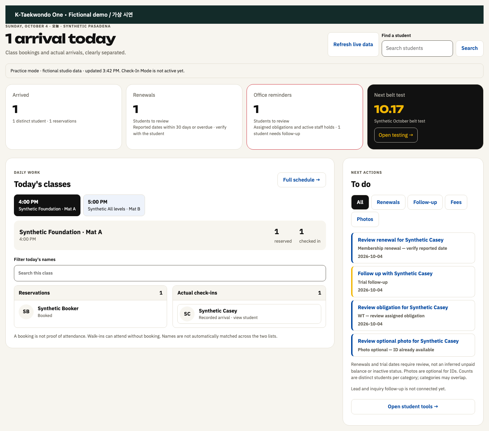
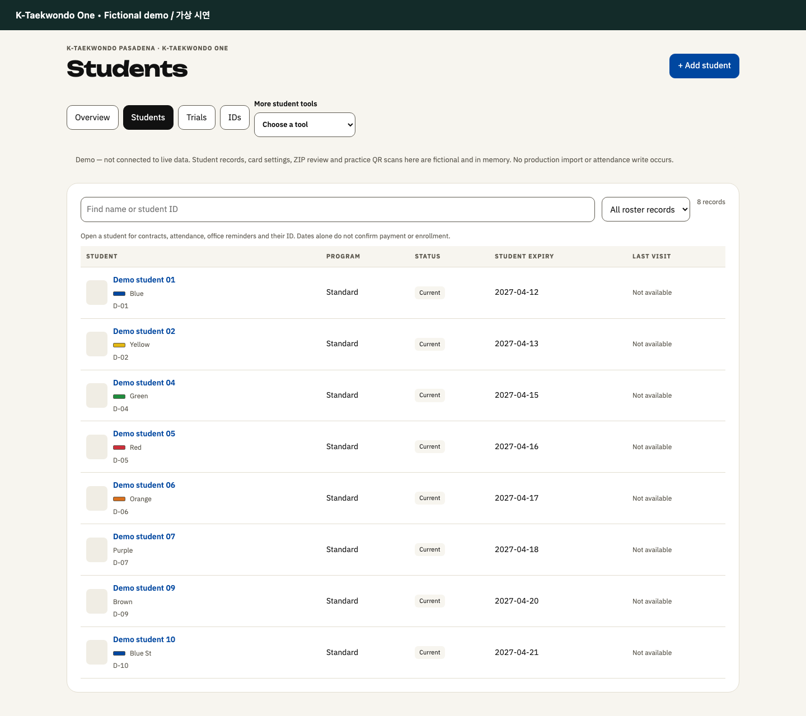
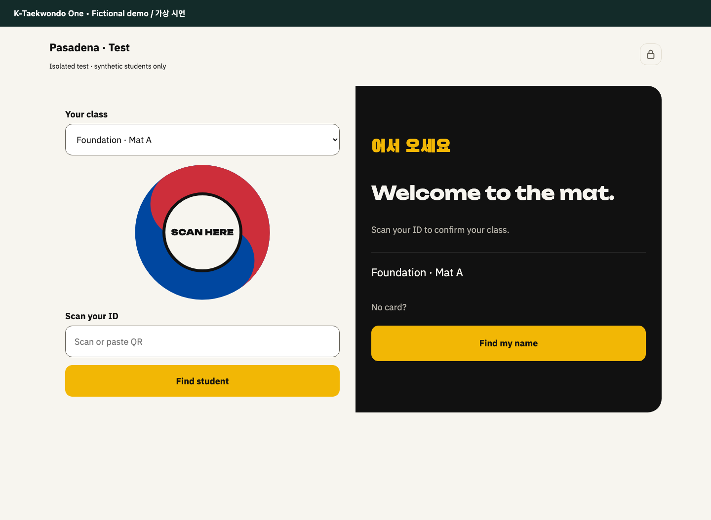

**Language / 언어:** [English](README.md) | **한국어**

# 케이태권도 원

**도장 운영을 하나의 흐름으로.**

케이태권도 원은 태권도 지도진과 사무 담당자의 일상 업무를 바탕으로 개발 중인 도장 운영 제품입니다. 수련생 관리, 수업 출석, 수련생 ID 및 담당자 검토 절차를 연결합니다.

> 이 저장소는 제품 소개 문서만 공개합니다. 애플리케이션 소스, 내부 인프라, 인증 정보 및 수련생 기록은 포함하지 않습니다. 일부 업무 흐름은 분리된 테스트 환경에서 검증되었으며, 전체 운영 출시 검증은 아직 진행 중입니다. 정식 서비스 출시를 의미하지 않습니다.

## 제품 화면

실제 애플리케이션 구성요소를 분리된 가상 시연 환경에서 캡처했습니다. 실제 수련생 기록 또는 운영 준비 완료를 의미하지 않습니다.

### 일일 운영

예약, 실제 출석 및 담당자 검토를 한 화면에서 확인합니다.

### 수련생 목록

가상의 수련생 기록에서 프로그램과 등급 정보를 확인합니다.

### 제한된 체크인

비공개 수련생 상세 정보 없이 출석 확인에 집중합니다.

## 살펴보기

- [제품 기능](docs/FEATURES.ko.md)
- [개발 로드맵](docs/ROADMAP.ko.md)
- [화면 및 미디어 공개 정책](docs/SCREENSHOTS.ko.md)
- [향후 SaaS 사업 방향](docs/SAAS-VISION.ko.md)
- [공개 자료 관리 원칙](docs/PUBLICATION-POLICY.ko.md)

## 제품 원칙

- **도장별 관리:** 권한, ID 표시 방식 및 운영 설정은 각 도장이 관리합니다.
- **명확한 출석:** 예약과 실제 출석은 별도로 기록합니다.
- **안정적인 식별:** 일반적인 프로필 또는 카드 디자인 변경으로 QR 인증 정보가 바뀌지 않습니다.
- **체크인 정보 최소화:** 출석 확인에 필요한 식별 정보와 일반적인 사무실 안내만 표시합니다.
- **담당자 검토:** 가져오기, 사진 연결 및 회원 등록·갱신 확인에 담당자 검토를 유지합니다.

## 제공 상태 및 의견

공개 가입, 요금, 서비스 보장 및 출시일은 아직 발표되지 않았습니다. 향후 SaaS 방향은 제안 단계이며, 현재 판매 중인 서비스 또는 인증 취득을 의미하지 않습니다.

저장소 이슈에는 일반적인 제품 의견만 남겨 주세요. 수련생 정보, 실제 운영 화면, 계정 정보 또는 민감한 내용이 포함된 보안 제보는 게시하지 마세요. 공개 데모 계정은 제공하지 않습니다.

© K-Taekwondo. 모든 권리 보유. 이 소개 자료는 애플리케이션 소스 또는 오픈소스 라이선스를 제공하지 않습니다.
